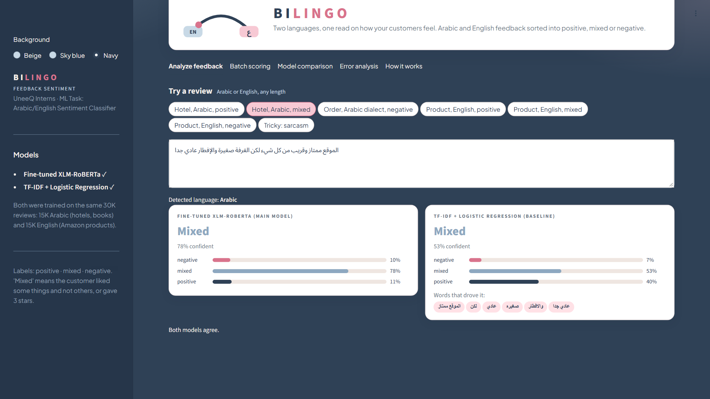
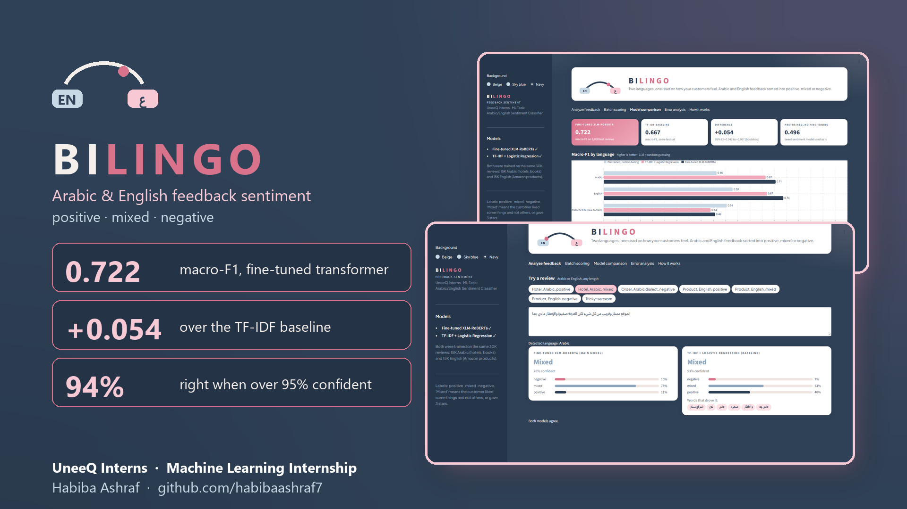
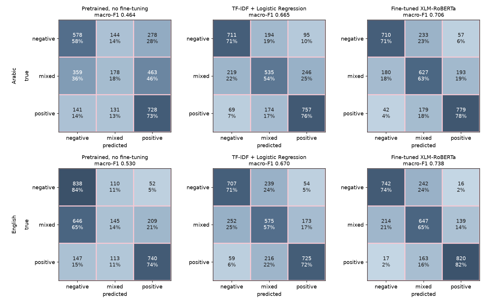
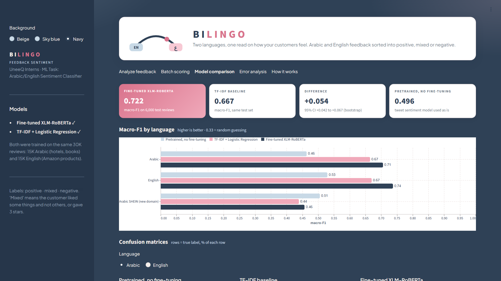
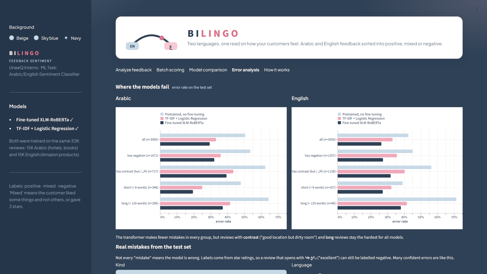

# BILINGO: Arabic / English Feedback Sentiment

A sentiment classifier for customer feedback written in Arabic or English. It sorts each message into **positive, mixed or negative**. Built for the UneeQ Interns machine learning internship.

I compared three approaches on the same data:
1. a classical TF-IDF baseline;
2. a fine-tuned multilingual transformer (XLM-RoBERTa);
3. a pretrained sentiment model used without any training on this data.



## Demo

[](demo/bilingo_demo.mp4)

A 90-second silent walkthrough with captions: [demo/bilingo_demo.mp4](demo/bilingo_demo.mp4). Click it, then "View raw" to play.

## Data

| Language | Dataset | Domain |
|---|---|---|
| Arabic | [Arabic 100K Reviews](https://huggingface.co/datasets/arbml/arabic_100k_reviews) | hotels and books |
| English | [Amazon Reviews (English)](https://huggingface.co/datasets/SetFit/amazon_reviews_multi_en) | products |
| Arabic, extra test only | [Arabic Reviews of SHEIN](https://huggingface.co/datasets/Ruqiya/Arabic_Reviews_of_SHEIN) | fashion, Gulf dialect |

- **Labels.** Star ratings are mapped to the three classes: 1–2 stars = negative, 3 = mixed, 4–5 = positive. The Arabic set already has these labels.
- **Splits.** Each language gets 5,000 / 1,000 / 1,000 reviews per class for train / validation / test, so neither language nor any class dominates.
- **SHEIN reviews** are never used for training. They show how the models do on a new domain and dialect.

## Approach

- **Cleaning.** Two levels of cleaning:
  - **Light** (transformer): remove URLs, HTML and mentions.
  - **Full** (TF-IDF): also unify Arabic letter forms (أ إ آ → ا, ى → ي, ة → ه), remove diacritics, lowercase, and shorten stretched words (رااائع, sooo).
  - I kept stopwords, because words like *not*, *but*, *لا* and *لكن* change the sentiment.
- **Baseline.** TF-IDF on words and character n-grams, plus logistic regression. Character n-grams help with Arabic words that have attached prefixes and suffixes.
- **Transformer.** `xlm-roberta-base` fine-tuned for 3 epochs on the same 30K training reviews (about 23 minutes on a laptop GPU).
- **Fair comparison.** Same training data, every choice made on validation data, and the test set used once at the end.

## Results

Macro-F1 on the test set (random guessing ≈ 0.33):

| Model | All | Arabic | English | SHEIN (new domain) |
|---|---|---|---|---|
| Pretrained tweet model, no fine-tuning | 0.496 | 0.464 | 0.530 | 0.506 |
| TF-IDF + logistic regression | 0.667 | 0.665 | 0.670 | 0.439 |
| **Fine-tuned XLM-RoBERTa** | **0.722** | **0.706** | **0.738** | 0.457 |

- **The fine-tuned transformer is the best model in both languages.** It beats the baseline by 0.054 macro-F1 (95% bootstrap interval 0.042 to 0.067).
- **Fine-tuning mattered more than the model type.** The pretrained transformer used as is loses to the simple baseline, mostly because it almost never predicts *mixed*.
- **The baseline is still a good option without a GPU.** It trains in 30 seconds and is 10 MB instead of 1.1 GB.



What I learned from the errors:
- **Most mistakes are between *mixed* and its neighbours.** Positive and negative are rarely swapped.
- **Reviews with "but" / "لكن" are the hardest.** "Good location but the room was dirty" sits right on the mixed boundary.
- **The baseline struggles with negation** ("doesn't feel cheap" → negative). The transformer handles it better.
- **Some "errors" are label noise.** A review that opens with "رائع جدا" (excellent) can still have a 2-star rating.
- **Confidence is useful.** When the transformer is over 95% sure (a third of the reviews), it's right 94% of the time. Below 60% it's close to a coin flip, so those reviews should go to a person.
- **On a new domain, every model drops to about 0.45.** SHEIN fashion reviews in Gulf dialect use words like يجنن and حلو that the training data rarely has.

Full details, with real examples of each kind of mistake, are in the [evaluation report](reports/evaluation_report.md) and the [notebook](notebooks/bilingo_sentiment.ipynb).

## Run it

Python 3.10+. A GPU is only needed to train the transformer.

```bash
git clone https://github.com/habibaashraf7/bilingo-sentiment-classifier.git
cd bilingo-sentiment-classifier
pip install -r requirements.txt
python -m src.data          # downloads the datasets from Hugging Face and builds the splits
python -m src.baseline      # trains the TF-IDF baseline (~3 min)
python -m src.transformer   # fine-tunes XLM-RoBERTa (~25 min on a GPU)
python -m src.evaluate      # test results, figures and error analysis
streamlit run app.py
```

The fine-tuned model is about 1.1 GB, so it isn't in the repo. Without it, the app and the inference script use the baseline.

**Inference script**

```bash
python -m src.predict "الفندق نظيف والموظفين محترمين" "Arrived broken, very disappointed"
python -m src.predict --file feedback.csv --column text      # scores a whole CSV
```

The app has five views:
1. **Analyze feedback:** both models side by side, with confidence and the words that drove the baseline.
2. **Batch scoring:** paste reviews or upload a CSV, then download the results.
3. **Model comparison:** scores, confusion matrices and a confidence check.
4. **Error analysis:** where the models fail, with real examples.
5. **How it works**

| Model comparison | Error analysis |
|---|---|
|  |  |

## Project structure

```
app.py               Streamlit demo
src/clean.py         text cleaning and language detection
src/data.py          download, label mapping, balanced splits
src/baseline.py      TF-IDF models, chosen on validation
src/transformer.py   XLM-RoBERTa fine-tuning + pretrained reference
src/evaluate.py      test results, confusion matrices, error analysis
src/predict.py       command-line inference
src/service.py       small Python API used by the app and scripts
notebooks/           walkthrough notebook
reports/             evaluation report, results, figures
```

## Limitations

- **Domains.** The training data covers hotels, books and products, so other domains and dialects need some labelled examples first.
- **Label noise.** Labels come from star ratings, which don't always match the text.
- **Sarcasm and idioms** are often read literally.
- **Long reviews.** The transformer only reads the first 192 tokens.
- **Mixed-language text is untested.** That includes Arabic and English in one message, and Arabizi ("7elw").

## Resources

| Resource | Used for |
|---|---|
| [Arabic 100K Reviews](https://huggingface.co/datasets/arbml/arabic_100k_reviews) | Arabic training and test data (hotels, books) |
| [Amazon Reviews, English](https://huggingface.co/datasets/SetFit/amazon_reviews_multi_en) | English training and test data |
| [Arabic Reviews of SHEIN](https://huggingface.co/datasets/Ruqiya/Arabic_Reviews_of_SHEIN) | new-domain test set (Gulf dialect) |
| [xlm-roberta-base](https://huggingface.co/FacebookAI/xlm-roberta-base) | the multilingual model that was fine-tuned |
| [cardiffnlp/twitter-xlm-roberta-base-sentiment](https://huggingface.co/cardiffnlp/twitter-xlm-roberta-base-sentiment) | the "no fine-tuning" reference model |
| [scikit-learn](https://scikit-learn.org/), [PyTorch](https://pytorch.org/), [Hugging Face Transformers](https://huggingface.co/docs/transformers) | TF-IDF baseline and transformer fine-tuning |
| [Conneau et al. (2020), Unsupervised Cross-lingual Representation Learning at Scale](https://arxiv.org/abs/1911.02116) | the XLM-RoBERTa paper |

## Data credits

The three datasets are public on Hugging Face (links above). Amazon and SHEIN are used only as sources of public review text. This project isn't affiliated with either company.
