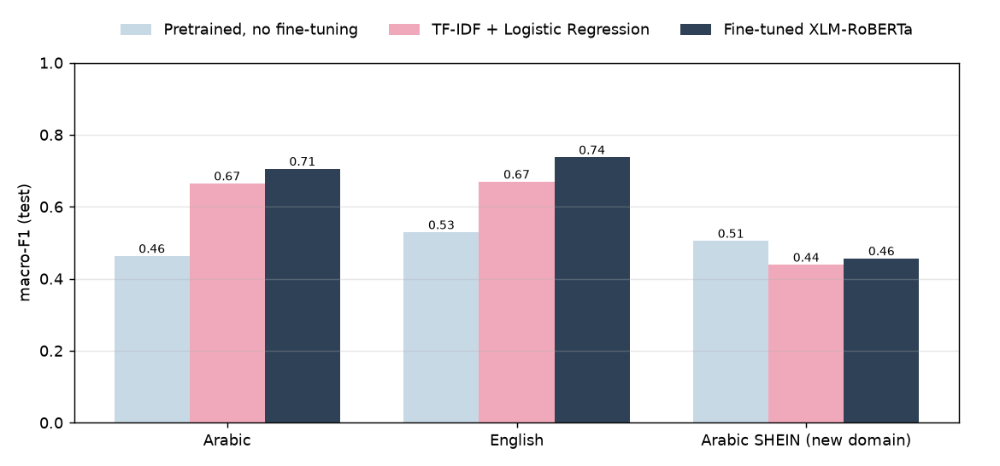
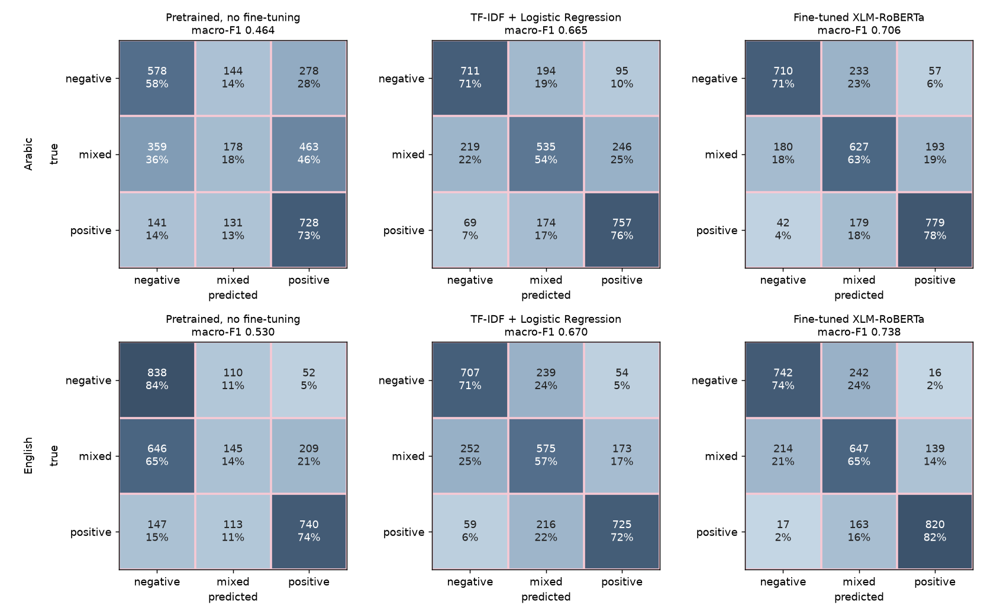

# Evaluation Report: BILINGO, Arabic / English Feedback Sentiment

**Task:** UneeQ Interns · Machine Learning track · *ML Task: Arabic/English Sentiment Classifier*

**Goal:** a company receives customer feedback in Arabic and English and wants each message sorted into **positive, mixed or negative**. Build a sentiment model and compare at least two approaches.

---

## 1. Summary

| Requirement | What was done |
|---|---|
| **Text cleaning** | Two cleaning levels: light for the transformer, full for TF-IDF (Arabic letter normalisation, diacritics, repeated letters, negation kept). Section 3 |
| **Classical baseline** | TF-IDF (words + character n-grams) + logistic regression, chosen from 7 candidates on validation. **0.667 macro-F1** on test |
| **Transformer option** | XLM-RoBERTa fine-tuned on the same data. **0.722 macro-F1** on test. A pretrained tweet model with no fine-tuning reaches 0.496 |
| **Fair comparison** | Same training data, same validation data for every choice, one test set used once. The difference is **+0.054** (95% CI +0.042 to +0.067) |
| **Error analysis** | Error rates by negation, contrast and length; real mistakes with explanations; confidence check. Section 7 |
| **Confusion matrix and examples** | Per model and per language. Section 6 |
| **Limitations** | Domain shift, label noise from star ratings, dialects, sarcasm, long reviews. Section 8 |

## 2. Data

| Language | Source | Domain | Labels |
|---|---|---|---|
| Arabic | [Arabic 100K Reviews](https://huggingface.co/datasets/arbml/arabic_100k_reviews) | hotels and books | Positive / Mixed / Negative (given) |
| English | [Amazon Reviews (English)](https://huggingface.co/datasets/SetFit/amazon_reviews_multi_en) | products | 1–2 stars = negative, 3 = mixed, 4–5 = positive |
| Arabic, new domain | [Arabic Reviews of SHEIN](https://huggingface.co/datasets/Ruqiya/Arabic_Reviews_of_SHEIN) | fashion, Gulf / Levantine dialect | same star mapping. **Test only, never trained or tuned on** |

**Why "mixed" and not "neutral"?** Customer reviews are rarely neutral. A 3-star review usually likes some things and dislikes others ("good location but the room was small"), and the Arabic dataset already calls this class *Mixed*.

**Splits.** For each language and each class: 5,000 train, 1,000 validation and 1,000 test reviews.

| Split | Reviews | Per language | Per class |
|---|---|---|---|
| Train | 30,000 | 15,000 | 5,000 |
| Validation | 6,000 | 3,000 | 1,000 |
| Test | 6,000 | 3,000 | 1,000 |
| SHEIN (new domain) | 2,115 | Arabic only | 1,408 positive, 360 mixed, 347 negative |

Balancing the data means both languages and all three classes count equally. A model can't look good just by being good at the biggest class.

**Duplicates.** Exact duplicates (after cleaning) were removed before splitting, so the same review can't appear in train and test. SHEIN reviews that also appear in training were removed from the SHEIN set.

## 3. Text cleaning

| Step | Transformer (light) | TF-IDF (full) |
|---|---|---|
| Remove URLs, HTML, @mentions, extra spaces | yes | yes |
| Arabic: remove diacritics and tatweel (ـ) | no | yes |
| Arabic: unify أ إ آ → ا, ى → ي, ة → ه, ؤ → و, ئ → ي | no | yes |
| Arabic-Indic digits → 0-9 | no | yes |
| Lowercase English, *n't* → *not* | no | yes |
| Squeeze repeated letters (رااااائع, sooooo) | no | yes |
| Keep emojis as their own tokens | yes | yes |
| Remove stopwords | **no** | **no** |

* The transformer gets almost raw text because its tokenizer was pretrained on raw text. Heavy cleaning would remove information it knows how to use.
* TF-IDF only sees exact tokens, so it needs spelling variants merged into one token.
* **Stopwords are kept on purpose.** *not*, *but*, *لا*, *لكن*, *بس* are exactly the words that flip or split sentiment.
* Language is detected by counting Arabic vs Latin letters. All 300K+ source reviews were detected as their expected language.

## 4. The approaches

**A. Classical baseline.** TF-IDF features feed a linear classifier. One model handles both languages.
* Word 1–2 grams catch phrases like "not good" and "لا أنصح".
* Character 2–5 grams help with Arabic, where one word appears with many attached prefixes and suffixes (الفندق / بالفندق / وفندقكم).

Candidates on validation (macro-F1):

| Model | Validation macro-F1 | Arabic | English | Fit time |
|---|---|---|---|---|
| Naive Bayes (words only) | 0.634 | 0.625 | 0.644 | 4 s |
| **Logistic regression, C=1** | **0.657** | **0.669** | **0.645** | 32 s |
| Logistic regression, C=0.5 | 0.657 | 0.669 | 0.645 | 21 s |
| Logistic regression, C=2 | 0.652 | 0.664 | 0.640 | 32 s |
| Linear SVM, C=0.1 | 0.652 | 0.665 | 0.639 | 15 s |

Logistic regression was chosen. It was the best on validation, and it gives probabilities, which the demo uses for confidence.

**B. Fine-tuned transformer.** `xlm-roberta-base` (pretrained on 100 languages including Arabic and English), fine-tuned on the same 30K training reviews.

| Setting | Value |
|---|---|
| Epochs | 3 |
| Learning rate | 2e-5 |
| Batch size | 16 |
| Max length | 192 tokens |
| Precision | mixed precision |
| Hardware / time | RTX 3060 laptop GPU, 23 minutes |
| Validation macro-F1 by epoch | 0.680 → 0.706 → **0.707** (best kept) |

**C. Reference: pretrained, no fine-tuning.** `cardiffnlp/twitter-xlm-roberta-base-sentiment` is a multilingual sentiment model trained on tweets, used as is. Its *neutral* class is mapped to *mixed*. It shows what you get by downloading a model without training on your own data.

## 5. Results (test set, used once)

| Model | All (6,000) | Arabic | English | SHEIN, new domain |
|---|---|---|---|---|
| Pretrained, no fine-tuning | 0.496 | 0.464 | 0.530 | **0.506** |
| TF-IDF + logistic regression | 0.667 | 0.665 | 0.670 | 0.439 |
| **Fine-tuned XLM-RoBERTa** | **0.722** | **0.706** | **0.738** | 0.457 |

*Macro-F1. Random guessing on three balanced classes scores about 0.33.*

Per-class F1 on the full test set:

| Model | negative | mixed | positive |
|---|---|---|---|
| Pretrained, no fine-tuning | 0.601 | 0.229 | 0.657 |
| TF-IDF + logistic regression | 0.706 | 0.564 | 0.732 |
| Fine-tuned XLM-RoBERTa | 0.744 | 0.623 | 0.799 |



**Is the gap real?** A paired bootstrap was used: the test set was resampled 2,000 times, and the difference was measured on the same reviews each time.

| Subset | Transformer − baseline | 95% interval |
|---|---|---|
| All | +0.054 | +0.042 to +0.067 |
| Arabic | +0.041 | +0.024 to +0.059 |
| English | +0.068 | +0.050 to +0.085 |
| SHEIN (new domain) | +0.018 | −0.005 to +0.039 (not significant) |

**Findings**
* **Fine-tuning matters more than the model.** The pretrained tweet model is a transformer too, but without training on reviews it barely predicts *mixed* (F1 0.23). It loses to the simple TF-IDF baseline by 0.17.
* **The fine-tuned transformer wins in both languages.** The gain is larger in English (+0.068) than in Arabic (+0.041).
* **The baseline is strong for its cost.** It trains in 30 seconds on a CPU, is 10 MB instead of 1.1 GB, and is only 0.05 behind. It's a sensible fallback when there's no GPU.
* **Out of domain, every model drops to about 0.45.** On SHEIN fashion reviews in Gulf dialect, the tweet model is best, because tweets are full of dialect. More in section 8.

## 6. Confusion matrices



* **Most mistakes involve *mixed*.** Negative and positive are rarely swapped by the trained models (2–10% of reviews), while 14–25% slide between *mixed* and its neighbours.
* **The transformer's biggest improvement is on *mixed*.** Recall for *mixed* rises from 54% to 63% in Arabic and from 57% to 65% in English.
* **The pretrained tweet model has almost no *mixed* class.** In English it sends 65% of mixed reviews to *negative*.

## 7. Error analysis

### 7.1 Where the models fail

Error rate on the test set:

| Group | Arabic: baseline | Arabic: transformer | English: baseline | English: transformer |
|---|---|---|---|---|
| All reviews | 33.2% | 29.5% | 33.1% | 26.4% |
| Has a negation (not, لا, ليس, مش…) | 36.0% | 32.2% | 35.7% | 27.3% |
| Has a contrast (but, لكن, بس…) | **43.5%** | **39.5%** | **40.4%** | **32.0%** |
| Short (< 8 words) | 25.0% | 19.5% | 32.4% | 27.2% |
| Long (> 120 words) | 41.6% | 37.2% | 41.7% | 38.1% |

* **Contrast is the hardest pattern.** "Good location but dirty room" is exactly the *mixed* boundary, and the label depends on how much weight the customer gave each part.
* **Negation hurts the baseline more**, especially in English (35.7% vs 27.3%). TF-IDF sees "cheap" and "not" as separate clues. The transformer reads them together.
* **Long reviews are hard for both models.** They often mix praise and complaints, and the transformer only reads the first 192 tokens.

### 7.2 Real examples

**The transformer fixes the baseline (negation and context)**

| Review | True | Baseline | Transformer |
|---|---|---|---|
| "Great product: doesn't feel cheap, even if it is made from plastic…" | positive | negative | positive |
| "Simply great! I don't need to waste paper towels no more…" | positive | negative | positive |
| ممتاز. القرب من الاسواق وكذلك وجود جاكوزي في الغرفه. اسكان شركات… رائحة طبخ سيئه | positive | mixed | positive |

The baseline sees *cheap*, *waste* and *no*, and votes negative. The transformer understands that they are negated, or outweighed by "great".

The Arabic hotel reviews follow a pattern: *one-word rating . what I liked . what I didn't like*. The transformer learned that the first word (ممتاز, جيد, سيئة) matters most.

**The baseline is right, the transformer is wrong (overconfident on the opening)**

| Review | True | Baseline | Transformer |
|---|---|---|---|
| ممتاز لكن أتوقع خدمة أفضل . … تنظيف الغرف بطئ… | mixed | mixed | positive (96%) |
| "About as comfortable as the original insoles that came with the boots" | mixed | mixed | positive (97%) |
| ليس في الإمكان أبدع مما كان ("it couldn't have been done better") | positive | positive | negative (96%) |

* The transformer sometimes trusts a positive opening (ممتاز) and ignores the complaints after لكن ("but").
* The last example is a classical Arabic idiom. It *contains* the negation ليس but means high praise, and the transformer reads the negation literally.

**Both are wrong, and the label is the problem**

| Review | Label | Both models |
|---|---|---|
| رائع جدا . الهدوء والاستقلالية. عدم السماح بالشواء ("excellent. quiet and private. no barbecues allowed") | negative | positive |
| "They fit, are soft, and so far have gone through 3 wash and dry cycles without issue." | mixed | positive |
| "DO NOT purchase this from AMAZON!!!! This ITEM is way OVERPRICED!!!!" | mixed | negative |

These labels come from star ratings, not from reading the text. A customer can write "excellent" and still give two stars, or write an angry review and give three. **Some of the "errors" are label noise.** Of the 1,675 transformer errors, 111 were made with over 95% confidence, and most of these look like this.

**Hard cases the models miss**
* **Sarcasm.** "Oh great, another charger that dies in two days. Exactly what I needed." Both models say *positive* (79% and 76%).
* **Dialect.** "الطلب وصل متأخر أسبوعين والمقاس مش مظبوط خالص" (Egyptian). The transformer gets it (negative, 95%). The baseline is unsure (mixed, 51%), because مش and مظبوط are rare in its mostly-MSA training data.

### 7.3 Can the confidence be trusted?

| Transformer confidence | Share of test reviews | Accuracy |
|---|---|---|
| over 95% | 32% | **94%** |
| 80–95% | 25% | 74% |
| 60–80% | 28% | 58% |
| under 60% | 15% | 47% |

The confidence is useful. A practical setup would accept the over-95% predictions automatically (a third of the volume, 94% correct) and send the low-confidence ones to a person.

## 8. Limitations

| Limitation | Effect | What would help |
|---|---|---|
| **Domain shift.** Arabic training data is hotels and books; English is products | On SHEIN fashion reviews, macro-F1 falls from 0.71 to 0.46. The model misses many positive dialect reviews (يجنن, حلو, روعه) | Label a few hundred reviews from the company's own channels and fine-tune on them |
| **Labels from star ratings** | Some "mistakes" are reviews whose text and stars disagree; the true accuracy ceiling is below 100% | Have people relabel a sample by reading the text |
| **Dialects.** Training Arabic is close to Modern Standard Arabic | Egyptian, Gulf and Levantine slang is weaker, especially for the baseline | Add dialect data, or start from an Arabic-dialect model (e.g. MARBERT) |
| **Sarcasm and idioms** | Read literally | Hard for any model of this size; route to human review |
| **Long reviews** | The transformer reads only the first 192 tokens | Longer max length, or split and average |
| **Mixed is subjective** | Even people disagree where *mixed* ends | Report *mixed* separately; a 2-class version (positive / negative) would score much higher |
| **Code-switching** (Arabic and English in one message, or Arabizi like "7elw") | Not in the training data, so untested | Collect real company messages |

**Use with a human in the loop.** The model is a triage tool. Use it to sort, count and prioritise feedback, not to make decisions about individual customers on its own.

## 9. Reproduce

```bash
pip install -r requirements.txt
python -m src.data          # downloads the datasets from Hugging Face, builds balanced splits (~25 s)
python -m src.baseline      # TF-IDF candidates, picks the best on validation (~3 min)
python -m src.transformer   # pretrained reference + fine-tune XLM-RoBERTa (~25 min on a GPU)
python -m src.evaluate      # test-set results, figures, error analysis
streamlit run app.py        # BILINGO demo
```
